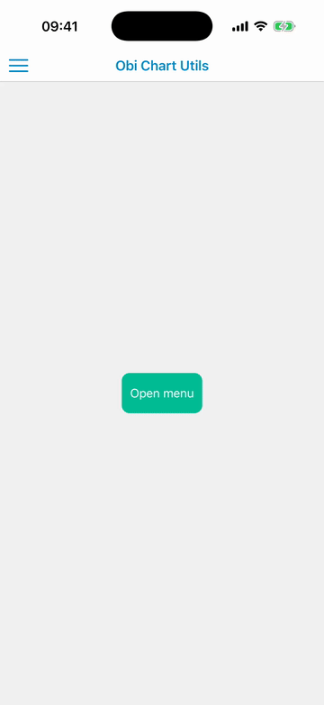
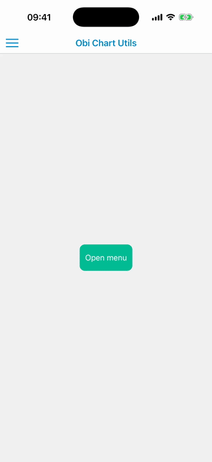

# @obitrain/charts

React Native charting primitives built on [React Native Skia](https://shopify.github.io/react-native-skia/),
[Reanimated](https://docs.swmansion.com/react-native-reanimated/) and
[Gesture Handler](https://docs.swmansion.com/react-native-gesture-handler/): animated line charts, a
zoomable/pannable variant, a scalable bottom axis and a cursor, all driven from the UI thread.

## Installation

```sh
yarn add @obitrain/charts
yarn add react-native-skia react-native-reanimated react-native-worklets react-native-gesture-handler d3-scale d3-shape
```

`react-native-worklets` is only needed with Reanimated 4 (it is an optional peer dependency).

## Requirements

| Peer dependency              | Supported versions                                    |
| ---------------------------- | ----------------------------------------------------- |
| `react-native-skia`          | `>=3.0.4` (Android minSdk 26)                          |
| `react-native-reanimated`    | 3.x or 4.x                                             |
| `react-native-worklets`      | `>=0.10.0` (optional, required with Reanimated 4)      |
| `react-native-gesture-handler` | 3.x (hook API)                                       |
| `d3-scale`                   | `>=4.0.2 <5.0.0`                                       |
| `d3-shape`                   | `>=3.2.0 <4.0.0`                                       |
| `react`                      | 18.x or 19.x                                           |
| `react-native`               | 0.61.5 up to 0.87                                      |

The exact ranges live in the `peerDependencies` of `package.json`. Development and tests run on
Expo SDK 57 / React Native 0.86 / Node `>= 20.19.4`.

## Usage

### Static line chart

`buildGraph` converts raw `[x, y][]` data into a `GraphData` (Skia path, data points, d3 scales).
`LineChart` renders one (`path`) or several (`paths`) paths on a Skia canvas:

```tsx
import { buildGraph, LineChart } from '@obitrain/charts';

const WIDTH = 300;
const HEIGHT = 140;

const data: [number, number][] = [
  [0, 10],
  [1, 25],
  [2, 18],
  [3, 40],
];

const graph = buildGraph(data, WIDTH, HEIGHT);

export function MyChart() {
  return (
    <LineChart
      path={graph.skiaPath}
      width={WIDTH}
      height={HEIGHT}
      color="dodgerblue"
    />
  );
}
```

Pass `opaque` when the chart covers its own background: on Android the canvas is then a `SurfaceView`,
the fastest path.

To draw the plot inside a bigger canvas (with your own axes, legends, ...), use `LinePlot`, which renders
the same paths without a `Canvas`:

```tsx
<Canvas style={{ width, height }}>
  <Group transform={[{ translateX: 40 }, { translateY: 20 }]}>
    <LinePlot paths={[{ path: graph.skiaPath, color: 'dodgerblue' }]} strokeWidth={1.5} />
  </Group>
</Canvas>
```

A `LinePath` can also fill the area under a static path (`fillOpacity`, fading to transparent) and colour
its stroke by value range with hard-stop `stops`, e.g. thresholds. `LinePlot` needs the plot `height`
for both (`LineChart` uses its height minus `offsetY`, or `plotHeight`):

```tsx
const stops = getBandStops(
  [{ from: 100, to: 130, color: 'teal' }, { from: 130, color: 'orange' }],
  graph.minY,
  graph.maxY,
  'grey'
);
<LinePlot height={height} paths={[{ path: graph.skiaPath, color: 'tomato', stops }]} />
```

`getNiceTicks(min, max, maxTicks)` returns round gridline values (steps of 1, 2, 2.5 or 5 × 10ⁿ) to bound
the plot with, and `YAxis` takes `labelAlign="left"` to print labels above full-width gridlines.

Inside a vertical `ScrollView`, pass `scrollable: true` to `useCursorGesture`: the cursor then only takes
over on a horizontal drag, and `isActive` tells whether a finger is driving it.

### Two axes and a range band

Two series with different units can share one set of gridlines: `getAlignedTicks(min, max, count)` returns
exactly `count` round ticks, so both axes built with the same `count` line up. Draw the gridlines once with a
label-less `YAxis` and put each scale's labels on its side with `AxisLabels`. `buildBandPath` fills the area
between a lower and an upper series, e.g. an expected range behind a line; pass it the line's domain:

```tsx
const kg = getAlignedTicks(minKg, maxKg, 4);
const pct = getAlignedTicks(minPct, maxPct, 4);
const band = buildBandPath(range, width, height, { minX, maxX, minY: kg[0], maxY: kg[3] });
<Canvas style={{ width, height }}>
  <YAxis width={width} height={height} font={font} minY={kg[0]} maxY={kg[3]} values={kg} showLabels={false} />
  <AxisLabels values={kg} minY={kg[0]} maxY={kg[3]} height={height} width={width} font={font} side="left" />
  <AxisLabels values={pct} minY={pct[0]} maxY={pct[3]} height={height} width={width} font={font} side="right" />
  <Path path={band} color="teal" opacity={0.2} />
</Canvas>
```

### Zoomable line chart

`useScalableGesture` provides the `scale`, `focalX` and `offsetX` shared values plus the pinch/pan
gestures (Gesture Handler 3 hooks) to compose with `useSimultaneousGestures` and wire into a `GestureDetector`.
Inside a vertical `ScrollView`, pass `scrollable: true` so the one-finger pan only takes over on a horizontal drag.
`onEnd` runs on the JS thread when a pinch or pan ends, e.g. to load the visible range as a new window:

```tsx
import {
  buildGraph,
  useScalableGesture,
  ZoomableLineChart,
} from '@obitrain/charts';
import { GestureDetector, useSimultaneousGestures } from 'react-native-gesture-handler';
import { useSharedValue } from 'react-native-reanimated';

export function MyZoomableChart() {
  const graph = buildGraph(data, WIDTH, HEIGHT);
  const path = useSharedValue(graph.skiaPath);

  const { scale, focalX, offsetX, pinchGesture, panGesture } =
    useScalableGesture({ width: WIDTH });

  const gesture = useSimultaneousGestures(pinchGesture, panGesture);

  return (
    <GestureDetector gesture={gesture}>
      <ZoomableLineChart
        width={WIDTH}
        height={HEIGHT}
        {...{ path, scale, focalX, offsetX }}
      />
    </GestureDetector>
  );
}
```

## What's inside

**Components** — `BottomAxis`, `AxisLine`, `Tick`, `Cursor`, `LineChart`, `LinePlot`, `YAxis`,
`ZoomableLineChart`, `ScalablePath`, `HeatStrip` (one-row heatmap of a series over time), `Ring` (donut),
`AxisLabels` (tick labels on either side, for a second axis).

**Hooks** — `useScalableGesture` (pinch/pan into a shared `scale`/`focalX`/`offsetX`),
`useCursorGesture` (continuous or discrete cursor), `useUpdateAxis` (swap axis labels on scale
thresholds), `useDotsTransition` (animate dots along a path), `useSharedNumberToStr`.

**Graph helpers** — `buildGraph`, `buildBandPath`, `scaleCommands`, `getClosestPoint`, `getPositionWl`,
`defaultOpacityTransitionWl`, `defaultTranslateTransitionWl`, `getNiceTicks`, `getAlignedTicks`, `getPaddedTicks`,
`getBandStops`, `getHeatCells`, `getRingArcs`.

**Math helpers** — `commandsToBezier`, `cubicBezierYForX`, `getYForX`, `magnitude`, `normalize`,
`selectCurve`.

**Date helpers** — `getMonthInterval`, `getDateInterval`, `getDateBoundaries`, `sampleDates`,
`sampleDatesByRange`.

**Types** — `AnimatedDot`, `DataPoint`, `LineGraphType`, `GraphData`, `Config`, `LinePath`,
`DateRange`, plus the component/hook prop types (`CursorProps`, `LineChartProps`,
`ZoomableLineChartProps`, `UseCursorGestureProps`, `UseDotAnimationProps`).

## Examples

### Bottom axis


`BottomAxis` with `useScalableGesture` and `useUpdateAxis`: zooming swaps the label set to match the
current scale. From `example/src/screens/BottomAxisScreen.tsx`.

### Line chart


`LineChart` interpolating between three paths, with animated dots and a `Cursor` — single path, then
several paths at once. From `example/src/screens/LineChartScreen`.

### Zoomable line chart



`ZoomableLineChart` with pinch/pan and a programmatic zoom onto a period between two data points.
From `example/src/screens/ZoomableLineChartScreen`.

### Dots


Dot transitions between data sets of different lengths, the primitive behind `useDotsTransition`.
From `example/src/screens/DotsScreen`.

### Advanced chart



Two series with hollow markers (ring and diamond), pinch-to-zoom with live-clamped panning, period
presets, and a light/dark themed time axis whose bucketing and labels adapt to the visible window
(years → months → weeks → days). See the [implementation notes](./docs/advanced-chart.md).
From `example/src/screens/AdvancedChartScreen`.

## Example app

```sh
yarn
yarn example ios     # or: yarn example android
```

Every demo screen is reachable through the `obichart://` scheme. Appending `?demo=1` replays a
scripted sequence of interactions on that screen (used to record the GIFs above):

```sh
xcrun simctl openurl booted "obichart://line-chart?demo=1"
```

Slugs: `bottom-axis`, `line-chart`, `zoomable-line-chart`, `dots`, `advanced-chart`.

## Regenerating the GIFs

```sh
yarn gifs                                  # all screens, builds the app in Release
yarn gifs --skip-build dots line-chart     # reuse the installed app, only these screens
yarn gifs --device "iPhone 17 Pro"
```

Requires Xcode with an iOS simulator, `ffmpeg` and `jq`. The script boots the simulator, freezes the
status bar, drives each screen through its deep link and writes `static/<slug>.gif`.

## Releasing

Releases are automated from conventional commits. Every push to `main` updates a "Release" pull
request (release-please) with the next version and changelog; merging it tags the release, creates the
GitHub release and publishes `@obitrain/charts` to npm from CI via trusted publishing, so no npm token
or one-time password is involved.

One-time setup on npmjs.com, under the package's *Settings → Trusted publishing*: add a GitHub Actions
publisher for `Obitrain/obi-chart` with workflow `release.yml`.

## Contributing

See the [contributing guide](CONTRIBUTING.md) to learn how to contribute to the repository and the development workflow.

## License

MIT
